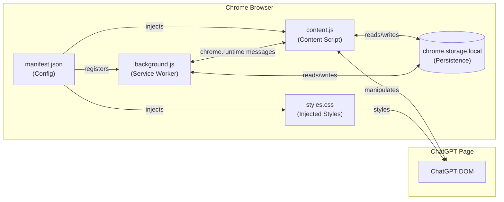
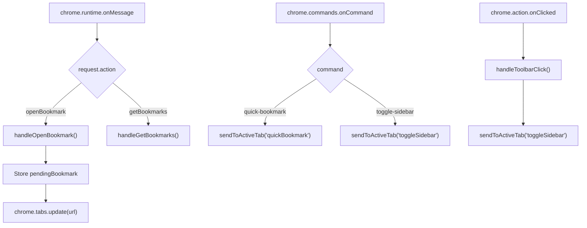
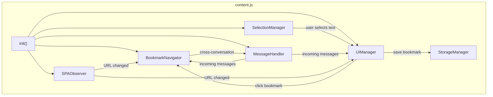
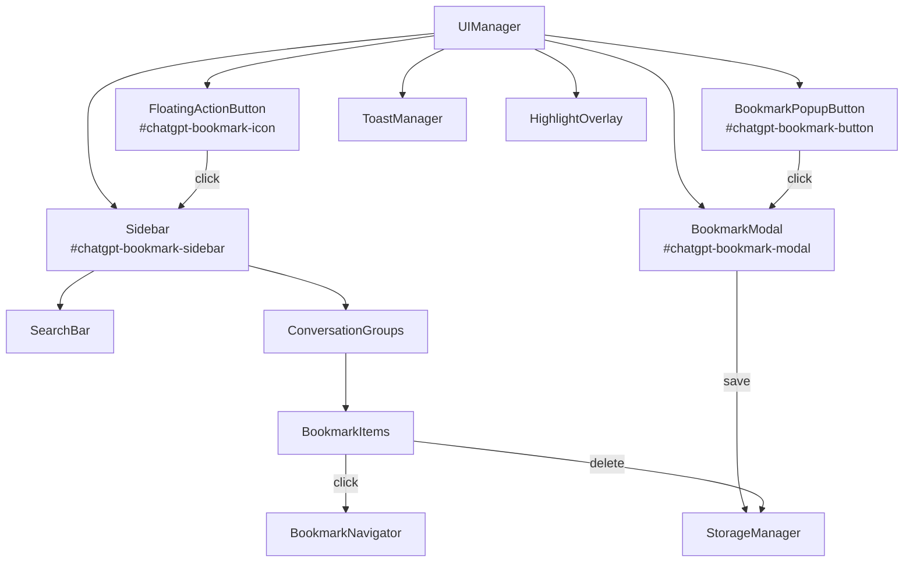
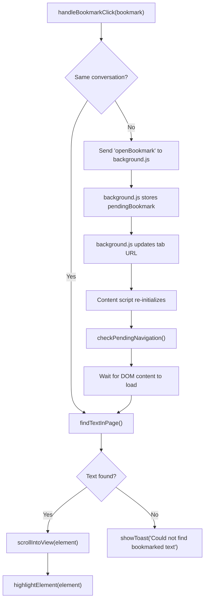
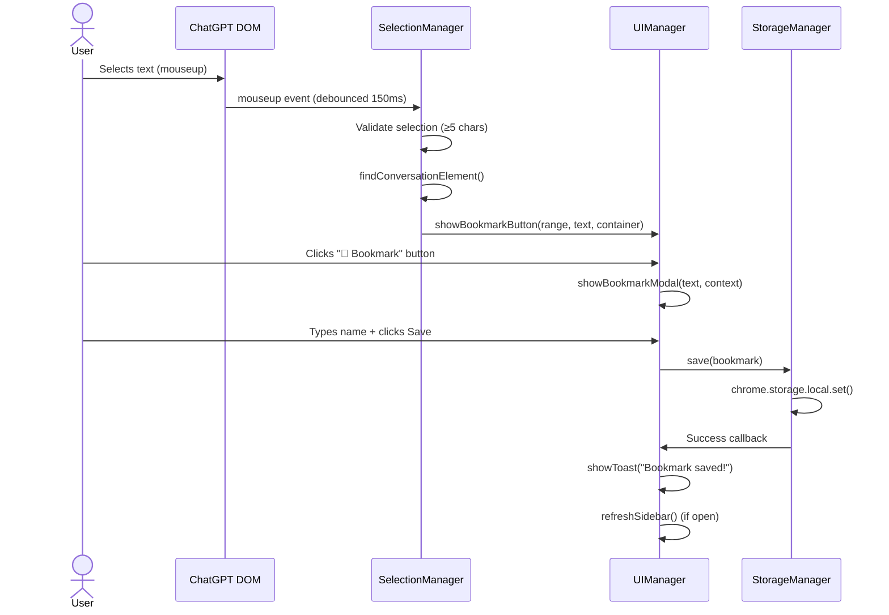
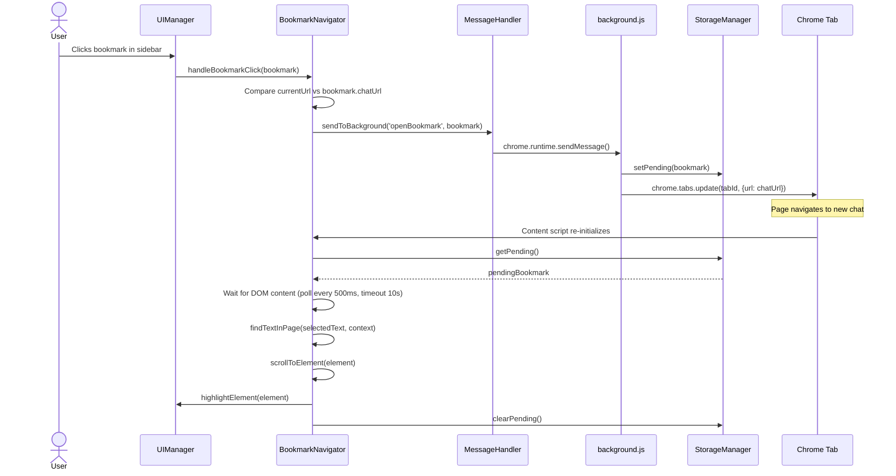
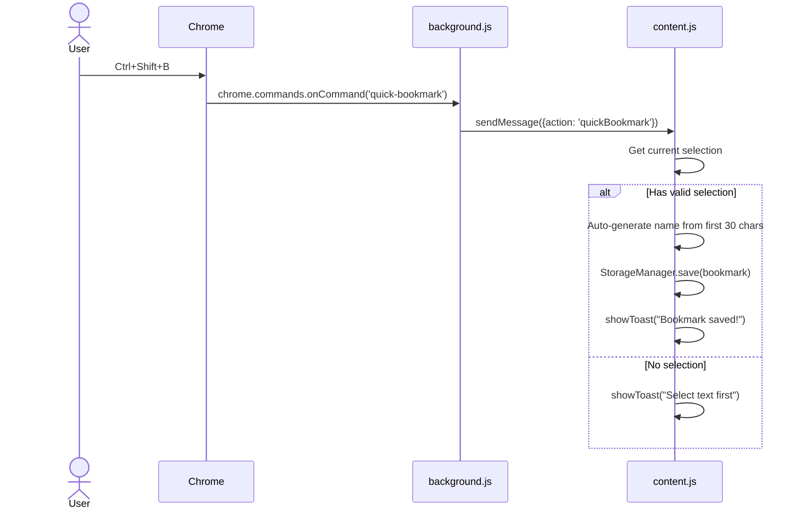

# ChatGPT Bookmarks — Architecture

> This document defines the complete technical architecture for rebuilding the extension.
> Reference: [problemstatement.md](file:///C:/Users/THARUN/.gemini/antigravity-ide/brain/fd7c296a-4f0d-42e2-9669-32b003508351/problemstatement.md)

---

## 1. System Overview

The extension follows Chrome's Manifest V3 architecture with three layers:



---

## 2. File Responsibilities

| File | Role | Layer |
|---|---|---|
| `manifest.json` | Extension configuration, permissions, script registration, keyboard shortcuts | Config |
| `background.js` | Service worker — handles cross-tab communication, toolbar icon clicks, tab management | Background |
| `content.js` | Injected into ChatGPT pages — all UI logic, DOM manipulation, bookmark CRUD, navigation | Content |
| `styles.css` | Injected into ChatGPT pages — all visual styling for extension UI components | Presentation |

---

## 3. `manifest.json` — Configuration

### Permissions Required

| Permission | Why |
|---|---|
| `storage` | Persist bookmarks in `chrome.storage.local` |
| `activeTab` | Access the currently active tab for toolbar icon actions |
| `tabs` | Open/update tabs for cross-conversation navigation |
| `scripting` | Programmatically inject scripts if needed |

### Key Additions (vs. original)

```json
{
  "commands": {
    "quick-bookmark": {
      "suggested_key": { "default": "Ctrl+Shift+B" },
      "description": "Bookmark selected text"
    },
    "toggle-sidebar": {
      "suggested_key": { "default": "Ctrl+Shift+K" },
      "description": "Toggle bookmarks sidebar"
    }
  }
}
```

### Host Permissions
```
*://chatgpt.com/*
*://chat.openai.com/*
```

---

## 4. `background.js` — Service Worker

### Architecture



### Module Breakdown

| Function | Purpose |
|---|---|
| `handleOpenBookmark(bookmark, senderTab)` | Stores `pendingBookmark` in storage, navigates the sender tab to `bookmark.chatUrl` |
| `handleToolbarClick(tab)` | Sends `{ action: 'toggleSidebar' }` message to the active ChatGPT tab |
| `sendToActiveTab(action, data)` | Helper — sends a message to the currently active tab's content script |

### Message Protocol (Incoming)

| `action` | Sender | Payload | Response |
|---|---|---|---|
| `openBookmark` | content.js | `{ bookmark }` | `{ success: true }` |
| `getBookmarks` | content.js | `{}` | `{ bookmarks: [...] }` |

### Message Protocol (Outgoing → Content Script)

| `action` | Trigger | Payload |
|---|---|---|
| `toggleSidebar` | Toolbar icon click or `Ctrl+Shift+K` | `{}` |
| `quickBookmark` | `Ctrl+Shift+B` command | `{}` |
| `navigateToBookmark` | After tab URL update completes | `{ bookmark }` |

---

## 5. `content.js` — Content Script

This is the largest and most complex file. It's organized into internal modules:

### Module Architecture



### 5.1 `SPAObserver` — SPA Navigation Detection

> [!IMPORTANT]
> This module solves the critical SPA bug from the original. ChatGPT uses `history.pushState` / `history.replaceState` for navigation — we must intercept these.

**Strategy — Dual approach:**

1. **Override `history.pushState` and `history.replaceState`**: Wrap the native methods to dispatch a custom `locationchange` event.
2. **Listen to `popstate`**: Catches browser back/forward navigation.
3. **Fallback: Polling interval**: Every 1 second, compare `window.location.href` to a cached value. This catches any edge cases the event-based approach misses.

```
┌─────────────────────────────────────────────┐
│              SPAObserver                     │
├─────────────────────────────────────────────┤
│ - currentUrl: string                        │
│ - observers: Set<Function>                  │
├─────────────────────────────────────────────┤
│ + start()                                   │
│ + stop()                                    │
│ + onUrlChange(callback)                     │
│ - patchHistoryAPI()                         │
│ - startPolling()                            │
│ - handleUrlChange(newUrl)                   │
└─────────────────────────────────────────────┘
```

**On URL change:**
- Update `currentUrl`
- Call `UIManager.updateBadgeCount()` (show bookmarks for new conversation)
- Call `BookmarkNavigator.checkPendingNavigation()` (if navigated here via a bookmark click)
- Refresh sidebar if open

---

### 5.2 `SelectionManager` — Text Selection Handling

**Responsibilities:**
- Listen for `mouseup` events (with debounce — 150ms)
- Validate selection (≥5 chars, inside a conversation element)
- Find the correct conversation container using resilient selectors
- Show/hide the bookmark popup button
- Extract surrounding context for precise re-location

**Resilient DOM Selectors (priority order):**
```javascript
const CONVERSATION_SELECTORS = [
  '[data-testid^="conversation-turn"]',  // Most specific
  'article[data-scroll-anchor]',          // ChatGPT article elements
  'div[data-message-id]',                 // Message containers
  'main .group',                          // Grouped messages
  'main',                                 // Fallback
];
```

> [!NOTE]
> We walk up the DOM from the selection, trying each selector. This multi-selector approach is resilient to ChatGPT DOM changes — if one selector breaks, the next one catches it.

**Scroll Container Detection:**
```javascript
function findScrollContainer() {
  // ChatGPT's scroll container is NOT window — it's a nested div
  const candidates = [
    document.querySelector('main .overflow-y-auto'),
    document.querySelector('main [class*="overflow"]'),
    document.querySelector('main')?.parentElement,
    document.querySelector('[role="presentation"]'),
  ];
  
  for (const el of candidates) {
    if (el && el.scrollHeight > el.clientHeight) return el;
  }
  return document.documentElement; // Ultimate fallback
}
```

---

### 5.3 `UIManager` — All UI Components

Manages creation, rendering, and interaction for all injected DOM elements:



#### UI Component Tree

```
body
├── #chatgpt-bookmark-icon          (Floating action button — always visible)
│   └── .bookmark-badge             (Count badge for current conversation)
│
├── #chatgpt-bookmark-button        (Popup — appears on text selection, removed on click-away)
│
├── #chatgpt-bookmark-modal         (Full-screen overlay — on bookmark creation)
│   └── .bookmark-modal-content
│       ├── h3 "Create Bookmark"
│       ├── #bookmark-name-input
│       ├── .bookmark-modal-preview
│       │   └── Selected text snippet
│       └── .bookmark-modal-buttons
│           ├── #bookmark-save-btn
│           └── #bookmark-cancel-btn
│
├── #chatgpt-bookmark-sidebar       (Slide-out panel — toggled by FAB or shortcut)
│   ├── .sidebar-header
│   │   ├── h2 "📚 Bookmarks"
│   │   └── #sidebar-close-btn
│   ├── .sidebar-search
│   │   └── #sidebar-search-input
│   ├── .sidebar-actions
│   │   ├── #sidebar-export-btn
│   │   └── #sidebar-import-btn
│   └── .sidebar-content
│       ├── .sidebar-loading         (Shown while loading)
│       ├── .sidebar-empty           (Shown when no bookmarks)
│       └── .conversation-group      (One per conversation URL)
│           ├── .group-header
│           │   ├── .group-title     (Chat name or URL)
│           │   └── .group-toggle    (Expand/collapse)
│           └── .bookmark-item      (One per bookmark)
│               ├── .bookmark-item-header
│               │   ├── .bookmark-name
│               │   ├── .bookmark-edit-btn
│               │   └── .bookmark-delete-btn
│               ├── .bookmark-preview
│               └── .bookmark-date
│
├── .chatgpt-bookmark-toast          (Transient — auto-removes after 2.5s)
│
└── .chatgpt-bookmark-highlight      (Transient — overlay pulse, removes after 2.5s)
```

---

### 5.4 `StorageManager` — Data Persistence

**All reads/writes go through this module** to keep storage logic centralized.

```
┌──────────────────────────────────────────────────┐
│                StorageManager                     │
├──────────────────────────────────────────────────┤
│ + getAll(): Promise<Bookmark[]>                  │
│ + getByConversation(url): Promise<Bookmark[]>    │
│ + save(bookmark): Promise<void>                  │
│ + update(id, fields): Promise<void>              │
│ + delete(id): Promise<void>                      │
│ + search(query): Promise<Bookmark[]>             │
│ + exportAll(): Promise<string>                   │
│ + importAll(json): Promise<void>                 │
│ + getPending(): Promise<Bookmark|null>           │
│ + setPending(bookmark): Promise<void>            │
│ + clearPending(): Promise<void>                  │
└──────────────────────────────────────────────────┘
```

**Storage Schema:**
```javascript
// chrome.storage.local
{
  "bookmarks": [
    {
      "id": "bm_1723456789_a1b2c3d4e",
      "name": "API rate limit explanation",
      "chatUrl": "https://chatgpt.com/c/abc-123-def",
      "chatTitle": "Node.js Backend Help",         // NEW — extracted from page
      "selectedText": "The rate limit is 60 requests per minute...",
      "context": {
        "before": "regarding the API limitations, ",
        "after": " which means you should implement"
      },
      "createdAt": "2026-08-12T09:00:00.000Z"
    }
  ],
  "pendingBookmark": null   // Set when navigating cross-conversation
}
```

> [!NOTE]
> New field `chatTitle` is extracted from the page's `<title>` or sidebar conversation list when saving. This enables grouping bookmarks by conversation name instead of raw URL.

**Text truncation rule**: If `selectedText` exceeds 2000 characters, truncate and store a flag `isTruncated: true`. The full match context (before/after) is always stored for navigation accuracy.

---

### 5.5 `BookmarkNavigator` — Finding & Scrolling to Bookmarks



**Text-finding algorithm (improved):**

```
findTextInPage(selectedText, context):
  1. Get the scroll container element
  2. Create a TreeWalker over the scroll container (not document.body)
  3. Collect all non-empty text nodes
  4. For each text node's parent element:
     a. Check if innerText contains selectedText
     b. If context.before exists, verify it appears within 100 chars before the match
     c. If context.after exists, verify it appears within 100 chars after the match
     d. If both context checks pass → return this element
  5. If no context match found, try plain text match (fallback)
  6. Return null if nothing found
```

**Scroll behavior (fixed):**
```javascript
function scrollToElement(element) {
  const scrollContainer = findScrollContainer();
  // Use the SCROLL CONTAINER, not window
  const containerRect = scrollContainer.getBoundingClientRect();
  const elementRect = element.getBoundingClientRect();
  const offset = elementRect.top - containerRect.top + scrollContainer.scrollTop;
  
  scrollContainer.scrollTo({
    top: offset - containerRect.height / 3,  // Position 1/3 from top
    behavior: 'smooth'
  });
}
```

**Highlight positioning (fixed):**
```javascript
function highlightElement(element) {
  // Use element.getBoundingClientRect() for viewport-relative positioning
  // Apply highlight as FIXED position (not absolute) to avoid scroll offset issues
  highlight.style.position = 'fixed';
  highlight.style.top = `${rect.top}px`;
  highlight.style.left = `${rect.left}px`;
  highlight.style.width = `${rect.width}px`;
  highlight.style.height = `${rect.height}px`;
}
```

---

### 5.6 `MessageHandler` — Chrome Message Bridge

```
┌──────────────────────────────────────────────────┐
│               MessageHandler                      │
├──────────────────────────────────────────────────┤
│ + init()                                         │
│ - handleIncoming(request, sender, sendResponse)  │
│ + sendToBackground(action, data): Promise        │
├──────────────────────────────────────────────────┤
│ Incoming actions handled:                        │
│   • toggleSidebar → UIManager.toggleSidebar()    │
│   • quickBookmark → SelectionManager.quickSave() │
│   • navigateToBookmark → Navigator.navigate()    │
└──────────────────────────────────────────────────┘
```

---

## 6. `styles.css` — Styling Architecture

### Design Tokens

All styling follows ChatGPT's design language — dark neutral backgrounds, clean typography, subtle shadows.

```css
/* Design Tokens (CSS Custom Properties) */
:root {
  /* Colors — Dark theme matching ChatGPT */
  --bm-bg-primary: #212121;
  --bm-bg-secondary: #2f2f2f;
  --bm-bg-hover: #383838;
  --bm-bg-active: #424242;
  --bm-text-primary: #ececec;
  --bm-text-secondary: #b4b4b4;
  --bm-text-muted: #8e8e8e;
  --bm-accent: #10a37f;
  --bm-accent-hover: #1a7f64;
  --bm-danger: #ef4444;
  --bm-border: #444444;
  --bm-overlay: rgba(0, 0, 0, 0.6);

  /* Spacing */
  --bm-space-xs: 4px;
  --bm-space-sm: 8px;
  --bm-space-md: 12px;
  --bm-space-lg: 16px;
  --bm-space-xl: 24px;

  /* Typography */
  --bm-font: -apple-system, BlinkMacSystemFont, 'Segoe UI', Roboto, sans-serif;
  --bm-font-sm: 12px;
  --bm-font-md: 14px;
  --bm-font-lg: 16px;

  /* Borders & Shadows */
  --bm-radius-sm: 6px;
  --bm-radius-md: 10px;
  --bm-radius-lg: 14px;
  --bm-radius-full: 50%;
  --bm-shadow: 0 4px 16px rgba(0, 0, 0, 0.3);
  --bm-shadow-lg: 0 8px 32px rgba(0, 0, 0, 0.4);

  /* Animation */
  --bm-transition: 0.2s ease;
  --bm-transition-slow: 0.3s ease;
}
```

### CSS Module Structure

```
styles.css
├── Design Tokens (CSS custom properties)
├── Base / Reset (scoped to extension selectors only)
├── Floating Action Button (#chatgpt-bookmark-icon)
│   └── Badge (.bookmark-badge)
├── Bookmark Popup Button (#chatgpt-bookmark-button)
├── Modal Overlay (#chatgpt-bookmark-modal)
│   ├── Modal Content (.bookmark-modal-content)
│   ├── Input (#bookmark-name-input)
│   ├── Preview (.bookmark-modal-preview)
│   └── Buttons (.bookmark-modal-buttons)
├── Sidebar (#chatgpt-bookmark-sidebar)
│   ├── Header (.sidebar-header)
│   ├── Search (.sidebar-search)
│   ├── Actions (.sidebar-actions)
│   ├── Content (.sidebar-content)
│   ├── Conversation Groups (.conversation-group)
│   ├── Bookmark Items (.bookmark-item)
│   └── Empty / Loading states
├── Toast (.chatgpt-bookmark-toast)
├── Highlight Overlay (.chatgpt-bookmark-highlight)
└── Animations (@keyframes)
    ├── slideIn / slideOut (sidebar)
    ├── fadeIn / fadeOut (modal, toast)
    └── pulse (highlight)
```

### Key Styling Decisions

| Decision | Rationale |
|---|---|
| **All selectors prefixed** with `#chatgpt-bookmark-` or `.chatgpt-bookmark-` or scoped under these | Prevents collision with ChatGPT's own styles |
| **`!important` on z-index** values | ChatGPT uses high z-index; our UI must be on top |
| **`position: fixed`** for sidebar, modal, FAB, toast | Independent of ChatGPT's scroll containers |
| **CSS custom properties** for theming | Easy to add light-mode support later |
| **No external fonts** | Uses system font stack to match ChatGPT and avoid CSP issues |
| **Smooth transitions** on all interactive elements | Premium feel — hover, focus, open/close |

### Sidebar Dimensions & Layout

```
┌──── Sidebar (360px wide, 100vh tall) ─────────────────┐
│ ┌── Header (56px) ──────────────────────────────────┐  │
│ │  📚 Bookmarks                              [✕]   │  │
│ └───────────────────────────────────────────────────┘  │
│ ┌── Search (48px) ──────────────────────────────────┐  │
│ │  🔍 Search bookmarks...                           │  │
│ └───────────────────────────────────────────────────┘  │
│ ┌── Actions (40px) ─────────────────────────────────┐  │
│ │  [Export]  [Import]                               │  │
│ └───────────────────────────────────────────────────┘  │
│ ┌── Content (flex: 1, overflow-y: auto) ────────────┐  │
│ │  ┌── Conversation Group ───────────────────────┐  │  │
│ │  │  ▼ Node.js Backend Help (3)                 │  │  │
│ │  │  ┌── Bookmark Item ──────────────────────┐  │  │  │
│ │  │  │  API rate limit explanation    [✎][🗑] │  │  │  │
│ │  │  │  "The rate limit is 60 req..."        │  │  │  │
│ │  │  │  Aug 12, 2026                         │  │  │  │
│ │  │  └──────────────────────────────────────┘  │  │  │
│ │  │  ┌── Bookmark Item ──────────────────────┐  │  │  │
│ │  │  │  ...                                  │  │  │  │
│ │  │  └──────────────────────────────────────┘  │  │  │
│ │  └─────────────────────────────────────────────┘  │  │
│ └───────────────────────────────────────────────────┘  │
└────────────────────────────────────────────────────────┘
```

---

## 7. Data Flow Diagrams

### 7.1 Creating a Bookmark



### 7.2 Navigating to a Bookmark (Cross-Conversation)



### 7.3 Keyboard Shortcut Flow



---

## 8. Error Handling Strategy

| Scenario | Handling |
|---|---|
| `chrome.storage` write fails | Show error toast, log to console, do not close modal |
| Bookmark text not found on page | Show "Could not find bookmarked text" toast |
| Cross-conversation navigation timeout (>10s) | Clear pending bookmark, show "Navigation timed out" toast |
| ChatGPT DOM selector fails | Fall through selector priority list; if all fail, show toast |
| Extension context invalidated (update/reload) | Catch `chrome.runtime` errors, prompt user to refresh |
| Storage quota exceeded (~10MB) | Show warning toast, suggest exporting and deleting old bookmarks |
| Import file invalid JSON | Show "Invalid file format" toast, do not overwrite data |

---

## 9. Performance Considerations

| Area | Strategy |
|---|---|
| **Selection listener** | Debounced at 150ms — prevents firing on every click/drag |
| **TreeWalker search** | Scoped to scroll container, not `document.body` — reduces search space |
| **Sidebar rendering** | Only re-render when sidebar is open; use `DocumentFragment` for batch DOM updates |
| **SPA URL polling** | 1-second interval — lightweight, only compares two strings |
| **Storage reads** | Cache bookmarks in memory after first load; invalidate cache on writes |
| **CSS animations** | Use `transform` and `opacity` only — GPU-accelerated, no layout thrashing |

---

## 10. Security Model

| Concern | Mitigation |
|---|---|
| **XSS via bookmark names** | All user input is escaped via `escapeHtml()` before DOM insertion |
| **Imported JSON injection** | Validate schema on import — only accept known fields, strip HTML |
| **Content Security Policy** | No external scripts, no `eval()`, no inline event handlers in HTML strings |
| **Storage access** | Only extension code can read `chrome.storage.local` — no page access |

---

## 11. File Size Estimates

| File | Estimated Lines | Notes |
|---|---|---|
| `manifest.json` | ~50 | Config + commands |
| `background.js` | ~80 | Lean service worker |
| `content.js` | ~600–700 | Core logic, all modules |
| `styles.css` | ~450–500 | Complete dark-theme styling |
| **Total** | ~1,200 | Entire extension |
