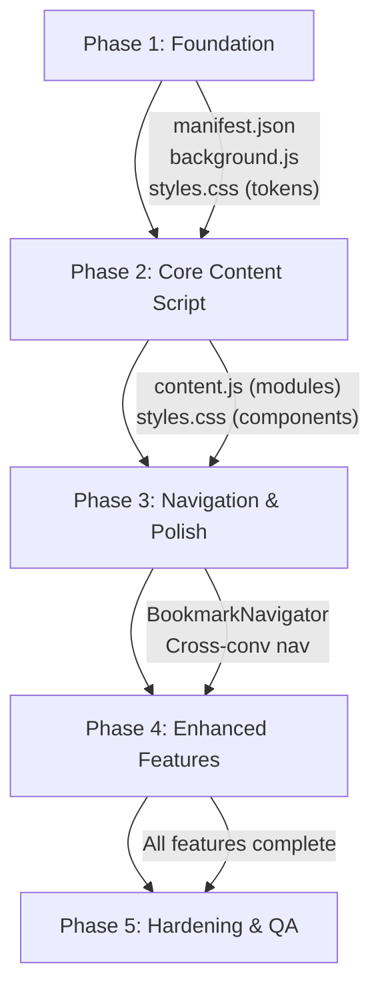

# ChatGPT Bookmarks — Phasewise Implementation Plan

> **References:**
> - [problemstatement.md](file:///c:/Users/THARUN/Desktop/bookmark-for-gpt/docs/problemstatement.md) — Vision, gaps, feature priorities
> - [architecture.md](file:///c:/Users/THARUN/Desktop/bookmark-for-gpt/docs/architecture.md) — System design, modules, data flows
> - [TRD.md](file:///c:/Users/THARUN/Desktop/bookmark-for-gpt/docs/TRD.md) — 30 FRs, 28 NFRs, API contracts, data schemas
> - [edgecases.md](file:///c:/Users/THARUN/Desktop/bookmark-for-gpt/docs/edgecases.md) — 43 edge cases with severity ratings
> - [TESTING.md](file:///c:/Users/THARUN/Desktop/bookmark-for-gpt/docs/TESTING.md) — 92 test cases mapped per phase
> - [CHANGELOG.md](file:///c:/Users/THARUN/Desktop/bookmark-for-gpt/docs/CHANGELOG.md) — Version history (update after each phase)
> - [README.md](file:///c:/Users/THARUN/Desktop/bookmark-for-gpt/docs/README.md) — User-facing docs (create at Phase 3)

---

## Overview

The rebuild is split into **5 phases**, each producing a testable, working increment. Each phase builds on the previous — no phase depends on a future one.

```
Phase 1 ─── Foundation (Config + Background + CSS Tokens)
   │
Phase 2 ─── Core Content Script (Modules + UI Components)
   │
Phase 3 ─── Navigation & Polish (Find Text + Scroll + Cross-Conv)
   │
Phase 4 ─── Enhanced Features (Search, Shortcuts, Export/Import)
   │
Phase 5 ─── Hardening (Error Handling, Performance, Edge Cases)
```

---

## Phase 1 — Foundation

> **Goal**: Get the skeleton running — manifest configured, background script functional, CSS design system in place.

### 1.1 `manifest.json` — Update Configuration

| Task | Detail |
|---|---|
| Add `commands` block | `quick-bookmark` (Ctrl+Shift+B), `toggle-sidebar` (Ctrl+Shift+K) |
| Verify permissions | `storage`, `activeTab`, `tabs`, `scripting` |
| Verify host permissions | `*://chatgpt.com/*`, `*://chat.openai.com/*` |
| Keep icon references | Reuse existing `icons/icon128.png` and `icons/icon48.png` |

### 1.2 `background.js` — Service Worker (from scratch)

| Task | Detail |
|---|---|
| `chrome.runtime.onMessage` listener | Handle `openBookmark` → store `pendingBookmark` + `chrome.tabs.update()` |
| `chrome.action.onClicked` listener | Send `{ action: 'toggleSidebar' }` to active tab |
| `chrome.commands.onCommand` listener | Route `quick-bookmark` → send `quickBookmark` to active tab |
| | Route `toggle-sidebar` → send `toggleSidebar` to active tab |
| `sendToActiveTab(action, data)` helper | Query active tab + `chrome.tabs.sendMessage()` |

### 1.3 `styles.css` — Design Tokens & Base Styles

| Task | Detail |
|---|---|
| CSS custom properties (`:root`) | All colors, spacing, typography, radii, shadows, transitions |
| Floating Action Button styles | `#chatgpt-bookmark-icon` — fixed position, circular, green, hover effect |
| Badge styles | `.bookmark-badge` — small red count circle on the FAB |
| Toast styles | `.chatgpt-bookmark-toast` + `.show` — slide-up notification with fade |
| Highlight overlay styles | `.chatgpt-bookmark-highlight` + `.pulse` — yellow overlay with pulse animation |
| `@keyframes` definitions | `fadeIn`, `fadeOut`, `slideInRight`, `slideOutRight`, `pulse` |

### Phase 1 — Definition of Done
- [ ] Extension loads in Chrome without errors
- [ ] Clicking toolbar icon sends `toggleSidebar` message (visible in console)
- [ ] Keyboard shortcuts registered (visible in `chrome://extensions/shortcuts`)
- [ ] CSS custom properties defined and ready for use

### Phase 1 — Test Suite
> Run tests **T1.01 – T1.08** from [TESTING.md](file:///c:/Users/THARUN/Desktop/bookmark-for-gpt/docs/TESTING.md)

| Test ID | What It Verifies |
|---|---|
| T1.01–T1.03 | Extension loads, no errors, icon in toolbar |
| T1.04–T1.05 | Toolbar icon sends correct messages |
| T1.06 | Keyboard shortcuts registered |
| T1.07–T1.08 | CSS tokens present, no style leaks |

### Phase 1 — Post-Phase Checklist
- [ ] All T1 tests pass
- [ ] Update [CHANGELOG.md](file:///c:/Users/THARUN/Desktop/bookmark-for-gpt/docs/CHANGELOG.md) — mark Phase 1 items as complete
- [ ] Commit: `feat: Phase 1 — foundation (manifest, background, CSS tokens)`

### Files Touched
| File | Action |
|---|---|
| `manifest.json` | **Overwrite** |
| `background.js` | **Write from scratch** |
| `styles.css` | **Write from scratch** (partial — tokens + FAB + toast + highlight) |

---

## Phase 2 — Core Content Script

> **Goal**: Rewrite `content.js` with modular architecture. Get bookmark creation working end-to-end (select → button → modal → save → toast). Sidebar shell visible.

### 2.1 Module: `SPAObserver`

| Task | Detail |
|---|---|
| Patch `history.pushState` / `replaceState` | Dispatch custom `locationchange` event |
| Listen to `popstate` | Handle browser back/forward |
| Polling fallback | 1-second interval comparing `window.location.href` |
| `onUrlChange(callback)` | Register callbacks for URL change events |
| Cleanup on `stop()` | Remove listeners, clear interval |

### 2.2 Module: `StorageManager`

| Task | Detail |
|---|---|
| `getAll()` | Returns all bookmarks from `chrome.storage.local` |
| `getByConversation(url)` | Filter bookmarks by `chatUrl` |
| `save(bookmark)` | Append to bookmarks array, enforce 2000-char text limit |
| `update(id, fields)` | Partial update (for inline name editing later) |
| `delete(id)` | Remove by ID |
| `getPending()` / `setPending()` / `clearPending()` | Manage `pendingBookmark` for cross-conversation nav |
| In-memory cache | Cache after first read, invalidate on write |

### 2.3 Module: `SelectionManager`

| Task | Detail |
|---|---|
| Debounced `mouseup` listener | 150ms debounce |
| `findConversationElement(node)` | Walk up DOM using resilient selector priority list |
| `findScrollContainer()` | Detect ChatGPT's actual scrollable `<div>` |
| `extractContext(text, container)` | 50 chars before/after the selection |
| `extractChatTitle()` | Get chat title from page `<title>` or sidebar |
| Show/hide bookmark popup button | Position relative to selection range |

### 2.4 Module: `UIManager` — Part 1

| Task | Detail |
|---|---|
| **Floating Action Button** | Inject `#chatgpt-bookmark-icon` with bookmark SVG, wire `click → toggleSidebar` |
| **Bookmark Popup Button** | `#chatgpt-bookmark-button` — appears near selection, disappears on click-away |
| **Bookmark Modal** | `#chatgpt-bookmark-modal` — overlay with name input, text preview, save/cancel |
| **Toast notifications** | `showToast(message)` — create element, animate in, auto-remove after 2.5s |
| **Sidebar shell** | `#chatgpt-bookmark-sidebar` — header + close button + empty content area (no bookmark rendering yet) |

### 2.5 Wire Everything Together

| Task | Detail |
|---|---|
| `init()` function | Start SPAObserver, set up SelectionManager, inject FAB, set up MessageHandler |
| Save flow | Modal save button → `StorageManager.save()` → toast |
| Delete flow | Delete button → `StorageManager.delete()` → refresh sidebar → toast |
| Message listener | `chrome.runtime.onMessage` → route `toggleSidebar`, `quickBookmark` |

### Phase 2 — Definition of Done
- [ ] Selecting text on ChatGPT shows the "🔖 Bookmark" button
- [ ] Clicking the button opens the modal with text preview
- [ ] Saving a bookmark stores it in `chrome.storage.local` (verifiable in DevTools → Application → Storage)
- [ ] Toast appears on save
- [ ] Floating icon visible, clicking it toggles sidebar (empty for now)
- [ ] SPA navigation detected in console logs when switching chats

### Phase 2 — Test Suite
> Run tests **T2.01 – T2.34** from [TESTING.md](file:///c:/Users/THARUN/Desktop/bookmark-for-gpt/docs/TESTING.md)

| Test ID | What It Verifies |
|---|---|
| T2.01–T2.05 | Floating action button (visibility, hover, click, SPA survival) |
| T2.06–T2.12 | Text selection & bookmark button (valid/invalid, positioning, code blocks) |
| T2.13–T2.22 | Bookmark modal (open, save, cancel, escape, storage) |
| T2.23–T2.25 | Toast notifications (appear, auto-dismiss, stacking) |
| T2.26–T2.28 | SPA navigation detection (URL change, back/forward, new chat) |
| T2.29–T2.34 | Sidebar shell (open, close, empty state, bookmark list, delete) |

> **Regression**: Also re-run T1.01–T1.08 from Phase 1

### Phase 2 — Edge Cases to Address
> From [edgecases.md](file:///c:/Users/THARUN/Desktop/bookmark-for-gpt/docs/edgecases.md):

| ID | Edge Case | Severity |
|---|---|---|
| 2.1 | SPA navigation (no page reload) | 🔴 Critical |
| 2.2 | React re-renders wipe injected elements | 🔴 Critical |
| 1.7 | Selection during streaming response | 🟠 High |
| 1.1 | Selection inside code block | 🟠 High |

### Phase 2 — Post-Phase Checklist
- [ ] All T2 tests pass + T1 regression passes
- [ ] Critical edge cases 2.1 and 2.2 handled
- [ ] Update [CHANGELOG.md](file:///c:/Users/THARUN/Desktop/bookmark-for-gpt/docs/CHANGELOG.md) — mark Phase 2 items as complete
- [ ] Commit: `feat: Phase 2 — core content script (selection, modal, sidebar, SPA)`

### Files Touched
| File | Action |
|---|---|
| `content.js` | **Write from scratch** |
| `styles.css` | **Append** — modal, sidebar, bookmark button styles |

---

## Phase 3 — Navigation & Polish

> **Goal**: Clicking a bookmark in the sidebar finds the text, scrolls to it, and highlights it — both same-conversation and cross-conversation.

### 3.1 Module: `BookmarkNavigator`

| Task | Detail |
|---|---|
| `findTextInPage(selectedText, context)` | TreeWalker scoped to scroll container, context matching |
| `scrollToElement(element)` | Use correct scroll container (not `window`), position 1/3 from top |
| `highlightElement(element)` | `position: fixed` overlay + yellow background flash |
| `handleBookmarkClick(bookmark)` | Same-conv → find+scroll; different-conv → send `openBookmark` to background |
| `checkPendingNavigation()` | On init + URL change, check for `pendingBookmark` and navigate |

### 3.2 Sidebar — Bookmark Rendering

| Task | Detail |
|---|---|
| `loadBookmarksIntoSidebar()` | Fetch from StorageManager, render as list items |
| Bookmark item click | → `BookmarkNavigator.handleBookmarkClick()` |
| Delete button | → `StorageManager.delete()` → refresh |
| Sort by `createdAt` | Newest first |
| Empty state | "No bookmarks yet" message with instructions |

### 3.3 Cross-Conversation Navigation

| Task | Detail |
|---|---|
| Content script: `checkPendingNavigation()` | Run on init + every URL change detected by SPAObserver |
| Wait for DOM content | Poll every 500ms until `main` has content (timeout 10s) |
| Clear pending after navigation | `StorageManager.clearPending()` |

### 3.4 Styling — Complete Sidebar & Modal

| Task | Detail |
|---|---|
| Sidebar slide-in/out animation | `transform: translateX()` with smooth transition |
| Bookmark item cards | Hover effects, delete button visibility on hover |
| Modal backdrop blur | `backdrop-filter: blur(4px)` |
| Input focus styles | Accent-colored border on focus |
| Button hover/active states | All buttons have proper interactive feedback |
| Scrollbar styling | Custom thin scrollbar for sidebar content |

### Phase 3 — Definition of Done
- [ ] Clicking a bookmark in sidebar scrolls to and highlights the text
- [ ] Highlight uses correct positioning (fixed, not absolute with window offset)
- [ ] Cross-conversation navigation works (click bookmark → page navigates → text found)
- [ ] Sidebar has polished animations and hover effects
- [ ] Modal looks premium with backdrop blur

### Phase 3 — Test Suite
> Run tests **T3.01 – T3.14** from [TESTING.md](file:///c:/Users/THARUN/Desktop/bookmark-for-gpt/docs/TESTING.md)

| Test ID | What It Verifies |
|---|---|
| T3.01–T3.04 | Same-conversation navigation (scroll, highlight, context match, not found) |
| T3.05–T3.07 | Cross-conversation navigation (URL change, pending cleared, timeout) |
| T3.08–T3.14 | Visual polish (animations, hover, blur, scrollbar, z-index, layout) |

> **Regression**: Also re-run T1.01–T2.34 from Phases 1–2

### Phase 3 — Edge Cases to Address
> From [edgecases.md](file:///c:/Users/THARUN/Desktop/bookmark-for-gpt/docs/edgecases.md):

| ID | Edge Case | Severity |
|---|---|---|
| 2.5 | Lazy-loaded conversation messages | 🟠 High |
| 4.1 | Bookmarked conversation was deleted | 🟠 High |
| 4.4 | Same text appears multiple times | 🟡 Medium |
| 5.1 | Z-index war with ChatGPT elements | 🟠 High |
| 6.1 | Tab closed during navigation | 🟡 Medium |

### Phase 3 — Documentation
- [ ] Copy [README.md](file:///c:/Users/THARUN/Desktop/bookmark-for-gpt/docs/README.md) to project root as the primary README

### Phase 3 — Post-Phase Checklist
- [ ] All T3 tests pass + T1–T2 regression passes
- [ ] High-severity edge cases from above handled
- [ ] Root `README.md` created from docs version
- [ ] Update [CHANGELOG.md](file:///c:/Users/THARUN/Desktop/bookmark-for-gpt/docs/CHANGELOG.md) — mark Phase 3 items as complete
- [ ] Commit: `feat: Phase 3 — navigation, cross-conv, visual polish`

### Files Touched
| File | Action |
|---|---|
| `content.js` | **Edit** — add BookmarkNavigator, sidebar rendering, pending nav |
| `styles.css` | **Edit** — complete sidebar items, modal polish, scrollbar |
| `README.md` (root) | **Create** — copy from docs/ |

---

## Phase 4 — Enhanced Features

> **Goal**: Add P1 (should-have) features that make the extension genuinely useful day-to-day.

### 4.1 Search & Filter

| Task | Detail |
|---|---|
| Search input in sidebar header | `#sidebar-search-input` with magnifying glass icon |
| Real-time filtering | Filter bookmarks as user types (by name + text content) |
| `StorageManager.search(query)` | Case-insensitive substring match on `name` and `selectedText` |
| Highlight matching text | Bold the matching substring in search results |
| Clear search button | X button to reset filter |

### 4.2 Conversation Grouping

| Task | Detail |
|---|---|
| Group bookmarks by `chatTitle` | Collapsible `.conversation-group` sections |
| Group header | Shows chat title + bookmark count |
| Expand/collapse toggle | Click group header to toggle visibility |
| Current conversation first | If on a ChatGPT page, show that conversation's group at top |
| Ungrouped fallback | Bookmarks without `chatTitle` go under "Other Conversations" |

### 4.3 Inline Name Editing

| Task | Detail |
|---|---|
| Edit button (✎) on bookmark items | Visible on hover, next to delete button |
| Click → transform name into input field | Pre-filled with current name |
| Enter or blur → save | `StorageManager.update(id, { name })` |
| Escape → cancel | Revert to original name |

### 4.4 Keyboard Shortcuts

| Task | Detail |
|---|---|
| `Ctrl+Shift+B` — Quick Bookmark | Auto-name from first 30 chars of selection, save immediately |
| `Ctrl+Shift+K` — Toggle Sidebar | Open/close sidebar |
| `Escape` — Close modal/sidebar | Close whichever is open |
| Handle "no selection" case | Show toast "Select text first" |

### 4.5 Export / Import

| Task | Detail |
|---|---|
| Export button in sidebar actions | `StorageManager.exportAll()` → JSON string → trigger file download |
| Import button in sidebar actions | Open file picker → read JSON → validate schema → `StorageManager.importAll()` |
| Import validation | Check for required fields (`id`, `name`, `chatUrl`, `selectedText`) |
| Merge vs. Replace | Import merges (skip duplicates by ID) — show count of new bookmarks added |

### 4.6 Badge Count

| Task | Detail |
|---|---|
| `.bookmark-badge` on FAB | Shows count of bookmarks for current conversation URL |
| Update on save/delete | Refresh count |
| Update on URL change | SPAObserver triggers count refresh |
| Hide when count is 0 | Badge not visible if no bookmarks for this conversation |

### Phase 4 — Definition of Done
- [ ] Typing in search bar filters bookmarks in real-time
- [ ] Bookmarks are grouped by conversation with collapsible headers
- [ ] Double-clicking or clicking edit icon on bookmark name allows inline editing
- [ ] `Ctrl+Shift+B` instantly saves a bookmark for the current selection
- [ ] Export downloads a `.json` file; Import loads bookmarks from a `.json` file
- [ ] Badge on floating icon shows correct count for current conversation

### Phase 4 — Test Suite
> Run tests **T4.01 – T4.35** from [TESTING.md](file:///c:/Users/THARUN/Desktop/bookmark-for-gpt/docs/TESTING.md)

| Test ID | What It Verifies |
|---|---|
| T4.01–T4.07 | Search & filter (real-time, case-insensitive, clear, no results, performance) |
| T4.08–T4.12 | Conversation grouping (groups, count, collapse, current-first, search+groups) |
| T4.13–T4.18 | Inline editing (edit icon, input, save, cancel, empty, persistence) |
| T4.19–T4.23 | Keyboard shortcuts (quick-bookmark, no selection, toggle, escape modal/sidebar) |
| T4.24–T4.30 | Export / Import (download, structure, zero, restore, merge, invalid, wrong schema) |
| T4.31–T4.35 | Badge count (show, hide, increment, decrement, URL change) |

> **Regression**: Also re-run T1.01–T3.14 from Phases 1–3

### Phase 4 — Edge Cases to Address
> From [edgecases.md](file:///c:/Users/THARUN/Desktop/bookmark-for-gpt/docs/edgecases.md):

| ID | Edge Case | Severity |
|---|---|---|
| 7.1 | Shortcut conflicts with browser | 🟠 High |
| 8.1 | Malformed JSON import | 🟠 High |
| 8.2 | Valid JSON but wrong schema | 🟠 High |
| 5.8 | Empty bookmark name | 🟡 Medium |
| 8.4 | Import from different version | 🟡 Medium |

### Phase 4 — Post-Phase Checklist
- [ ] All T4 tests pass + T1–T3 regression passes
- [ ] Import/export edge cases handled
- [ ] Update root `README.md` with new features (search, shortcuts, export/import)
- [ ] Update [CHANGELOG.md](file:///c:/Users/THARUN/Desktop/bookmark-for-gpt/docs/CHANGELOG.md) — mark Phase 4 items as complete
- [ ] Commit: `feat: Phase 4 — search, grouping, shortcuts, export/import, badge`

### Files Touched
| File | Action |
|---|---|
| `content.js` | **Edit** — add search, grouping, editing, shortcuts, export/import, badge |
| `styles.css` | **Edit** — search bar, group headers, edit mode, badge, import/export buttons |

---

## Phase 5 — Hardening & QA

> **Goal**: Make it production-ready — handle all edge cases, optimize performance, polish every interaction.

### 5.1 Error Handling

| Task | Detail |
|---|---|
| Storage write failures | Show error toast, do not close modal, log to console |
| Extension context invalidated | Wrap all `chrome.runtime` calls in try-catch, show "Please refresh" toast |
| Storage quota warning | Check usage after each write, warn at 80% capacity |
| Import validation failures | Show specific error (e.g., "Invalid JSON", "Missing required fields") |
| DOM selector failures | Fall through priority list; log which selectors failed |

### 5.2 Performance Optimization

| Task | Detail |
|---|---|
| Debounce selection handler | Already done (150ms) — verify no edge cases |
| DocumentFragment for sidebar | Batch DOM updates instead of individual `innerHTML` assignments |
| Scope TreeWalker | Ensure it searches scroll container, not entire body |
| Lazy sidebar rendering | Only render when sidebar is opened |
| Cache invalidation | Verify cache is correctly invalidated on every write operation |
| Animation performance | Audit all animations use `transform`/`opacity` only |

### 5.3 Edge Case Testing

| Scenario | Expected Behavior |
|---|---|
| Select text inside a code block | Bookmark works, preserves code text |
| Select text spanning multiple messages | Bookmark saves, context may be imprecise — should still navigate |
| Very long selection (>2000 chars) | Text truncated, `isTruncated: true` flag set, navigation still works |
| ChatGPT in light mode | Extension UI should still look acceptable (dark sidebar on light page) |
| Bookmark text was edited by ChatGPT (response regenerated) | "Could not find bookmarked text" toast — expected |
| Multiple rapid bookmark saves | No duplicate IDs, no race conditions in storage |
| Open sidebar → switch conversation (SPA) → sidebar should refresh | Sidebar content updates for new conversation |
| Extension updated while tab is open | Graceful degradation — "Please refresh" on next interaction |
| 100+ bookmarks | Sidebar scrolls smoothly, search is responsive |
| Empty bookmark name submitted | Save button disabled or prompt required — prevent saving |

### 5.4 Final Polish

| Task | Detail |
|---|---|
| Verify all transitions are smooth | No janky animations |
| Verify z-index layering | Modal > Sidebar > FAB > Toast > Highlight > ChatGPT UI |
| Verify no style leaks | Extension CSS doesn't affect ChatGPT's own styling |
| Verify no console errors | Clean console in all normal flows |
| Test on Edge and Brave | Chromium compatibility check |

### Phase 5 — Definition of Done
- [ ] All error scenarios show user-friendly toasts (never silent failures)
- [ ] No console errors in normal usage flows
- [ ] Sidebar renders 100+ bookmarks without lag
- [ ] All edge cases in the table above are handled
- [ ] Extension looks polished and feels native to ChatGPT

### Phase 5 — Test Suite
> Run **ALL** tests **T1.01 – T5.21** from [TESTING.md](file:///c:/Users/THARUN/Desktop/bookmark-for-gpt/docs/TESTING.md) — full regression

| Test ID | What It Verifies |
|---|---|
| T5.01–T5.04 | Error handling (storage failure, context invalidation, corrupted data, stale pending) |
| T5.05–T5.08 | Performance (latency, 100 bookmarks, search speed, memory) |
| T5.09–T5.16 | Edge cases (streaming, multi-message, long text, rapid clicks, SPA+sidebar, lazy load) |
| T5.17–T5.18 | Cross-browser (Edge, Brave) |
| T5.19–T5.21 | Accessibility (ARIA roles, keyboard nav, focus trap) |

### Phase 5 — Verification Against Requirements
> Verify all requirements from [TRD.md](file:///c:/Users/THARUN/Desktop/bookmark-for-gpt/docs/TRD.md):

- [ ] All 30 Functional Requirements (FR-01 through FR-30) verified
- [ ] All 28 Non-Functional Requirements (NFR-01 through NFR-28) verified
- [ ] All 12 error types in the Error Taxonomy handled
- [ ] All 43 edge cases from [edgecases.md](file:///c:/Users/THARUN/Desktop/bookmark-for-gpt/docs/edgecases.md) addressed (4 critical, 8 high mandatory; medium/low as feasible)

### Phase 5 — Post-Phase Checklist
- [ ] All 92 test cases pass (full suite T1–T5)
- [ ] Update root `README.md` with final known limitations
- [ ] Update [CHANGELOG.md](file:///c:/Users/THARUN/Desktop/bookmark-for-gpt/docs/CHANGELOG.md) — mark Phase 5 complete, set version to `1.0.0`
- [ ] Final commit: `release: v1.0.0 — ChatGPT Bookmarks`
- [ ] Tag: `git tag v1.0.0`

### Files Touched
| File | Action |
|---|---|
| `content.js` | **Edit** — error handling wrappers, performance tweaks |
| `styles.css` | **Edit** — final polish, z-index audit |
| `background.js` | **Edit** — error handling in message handlers |

---

## Phase Summary

| Phase | Focus | Key Deliverable | Est. Files Changed |
|---|---|---|---|
| **1** | Foundation | Working manifest + background + CSS tokens | 3 files (new) |
| **2** | Core Content Script | Select → Bookmark → Save flow works | 2 files |
| **3** | Navigation & Polish | Click bookmark → scroll → highlight works | 2 files |
| **4** | Enhanced Features | Search, groups, shortcuts, export/import | 2 files |
| **5** | Hardening | Error handling, performance, edge cases | 3 files |

---

## Dependency Graph



---

## Execution Rules

1. **Each phase is independently testable** — load the extension after each phase and verify it works.
2. **No phase skipping** — Phase 3 depends on Phase 2's modules, Phase 4 depends on Phase 3's navigator.
3. **CSS grows incrementally** — each phase adds styles for the components it introduces.
4. **Test on real ChatGPT** — after each phase, load the extension on `chatgpt.com` and verify.
5. **Run the test suite after each phase** — use [TESTING.md](file:///c:/Users/THARUN/Desktop/bookmark-for-gpt/docs/TESTING.md) test IDs. Run the current phase's tests + regression from all prior phases.
6. **Update the changelog after each phase** — mark completed items in [CHANGELOG.md](file:///c:/Users/THARUN/Desktop/bookmark-for-gpt/docs/CHANGELOG.md).
7. **Commit after each phase** — clean git history with one commit per phase.
8. **Address critical & high edge cases in-phase** — reference [edgecases.md](file:///c:/Users/THARUN/Desktop/bookmark-for-gpt/docs/edgecases.md). 🔴 Critical = must fix in the phase that introduces the feature. 🟠 High = must fix by Phase 5.
9. **Validate against TRD at Phase 5** — use [TRD.md](file:///c:/Users/THARUN/Desktop/bookmark-for-gpt/docs/TRD.md) as the final acceptance checklist for all FRs and NFRs.
